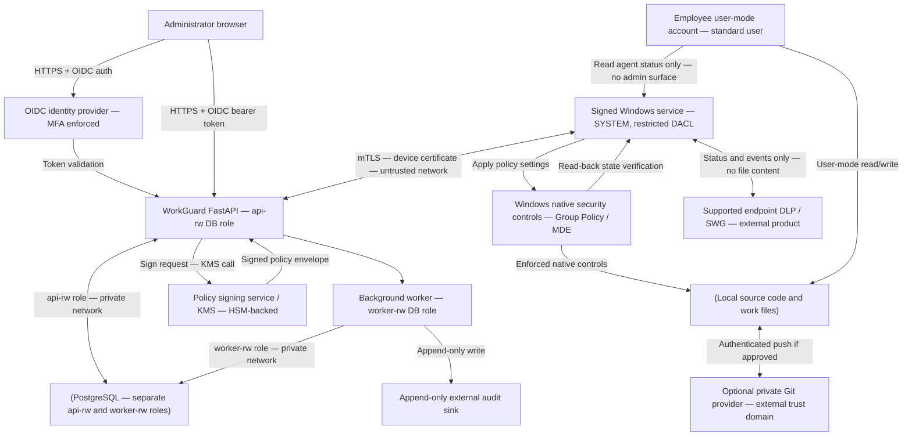
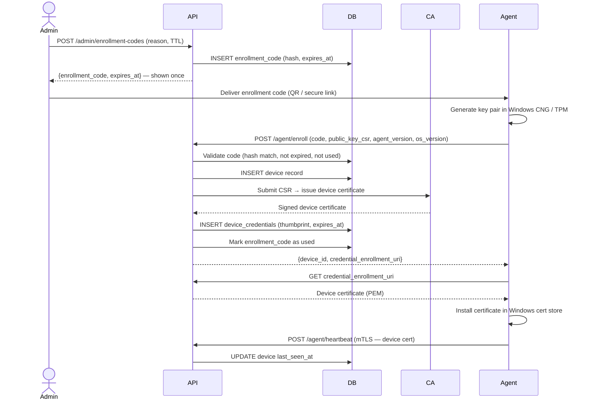

# WorkGuard Architecture

## 1. Purpose

WorkGuard is a policy-management and security-reporting system for company-managed Windows endpoints. Source code and active project files remain on each employee laptop by default. The control plane holds identities/references, device metadata, policy definitions, enforcement receipts, audit events, and alerts—not source code or file contents.

**Security claim boundary:** WorkGuard can reduce common leakage channels and improve visibility. It cannot guarantee zero leakage when users can view plaintext code locally.

**Related specifications:** `SIGNING_SPEC.md` is the canonical source of truth for the policy signing algorithm, canonical encoding, and key management. `ENDPOINT_AGENT.md §9` defines the device PKI. `CHANNEL_COVERAGE.md` documents DLP channel coverage status. `EMPLOYEE_NOTICE.md` is the employee-facing privacy notice template.

## 2. Architecture principles

1. **Use OS-native controls:** do not invent kernel drivers or cryptography for the MVP.
2. **Policy is not enforcement:** report `enforced` only when the agent has independently verified the actual control state.
3. **Default deny for sensitive operations:** unknown devices, invalid policies, expired credentials, and unapproved destinations must not receive new privileges.
4. **Local-first work:** the agent must not upload source code, file contents, clipboard contents, keystrokes, screenshots, or file bodies to the control plane.
5. **Separate management from content:** control-plane outage must not silently disable already-applied OS security policy.
6. **Least privilege:** each service, administrator, and integration receives only required access. The background worker and the API use separate, least-privilege database roles.
7. **Signed, versioned policy:** authenticated transport plus policy signature/hash, version, issue time, expiry, and rollback protections (see `SIGNING_SPEC.md`).
8. **Transparent monitoring:** publish an employee-facing notice describing collected metadata, purposes, access, and retention (see `EMPLOYEE_NOTICE.md`).

## 3. Logical components

### 3.1 Admin web application

- React + TypeScript.
- OIDC-based administrator login with MFA enforced by the identity provider.
- Role-scoped views: devices, policy templates, assignments, drift, events, audit and approvals.
- The frontend is untrusted. The API makes every authorization decision.

### 3.2 Control API

- Python + FastAPI.
- PostgreSQL for relational state.
- Background worker for notification, event enrichment, policy expiry and alerting.
- Object storage only for release packages or policy artifacts if necessary—not employee source code.
- Central secret manager for service credentials and signing keys.
- Rate limits, request-size limits, schema validation and structured redacted logs.

### 3.3 Device registry

A device is enrolled using a one-time enrollment code or admin-approved enrollment workflow. Upon enrollment, the device receives its own client credential/certificate. Never ship a shared secret in the installer. Device removal revokes its credential and rejects future requests.

### 3.4 Windows endpoint agent

- C#/.NET Windows service installed by an administrator or approved device-management workflow.
- Runs with only the privileges required for its selected integrations.
- Does not expose a local unauthenticated command endpoint.
- Fetches signed policy, validates schema/signature/version/expiry, applies it through supported Windows policy interfaces, then verifies and reports resulting state.
- Reports device health, policy version, control status, security event metadata and agent version.
- Does not upload source files or enumerate private file contents by default.
- Uses signed update packages, secure rollback, and an auditable installer/uninstaller process.

### 3.5 Enforcement adapters

Keep provider-specific code behind interfaces, such as:

- `RemovableStorageControl`: native Windows policy or supported endpoint-security device control.
- `ApplicationControl`: App Control for Business or AppLocker integration.
- `DiskEncryptionStatus`: query BitLocker/device encryption state; do not invent encryption.
- `EndpointDlpProvider`: integration/status adapter to a supported DLP provider. It may report policy status and events, but must not claim coverage outside the provider's documented scope.
- `NetworkPolicy`: supported firewall, DNS filtering or secure-web-gateway integration.

If an adapter cannot enforce a rule on a device/edition, report `unsupported` or `not_configured`, never `enforced`.

### 3.6 Optional hosted Git

A private hosted Git service can support code review, collaboration and backup. Repository authorization, MFA, branch protection, secret scanning and audit history are separate controls. If the requirement is that code never leave laptops, do not enable remote push; document the impact on collaboration and recovery.

## 4. Trust boundaries and data flow



### Data that may leave an endpoint

Allowed by default:
- Device ID, OS build/edition, agent version, last-seen time.
- Policy identifier/version, control state and verification timestamp.
- Security event metadata such as event type, timestamp, process signer/name where needed, and destination domain if the selected provider supports it and policy allows collection.

Not collected by default:
- Source-code contents or file bodies.
- Keystrokes, clipboard contents, screenshots, microphone, webcam, browsing history unrelated to security policy, or personal files.

Any expansion of telemetry needs a privacy/security review, explicit policy update and notice.

## 5. Policy lifecycle

1. Administrator creates or edits a policy draft.
2. API validates schema and permissions; changes require reason and are audit logged.
3. For high-impact controls, a second administrator (different from the author) approves the policy.
4. A release process signs the canonical policy envelope using the KMS signing service (algorithm: Ed25519 over JCS-canonical bytes — see `SIGNING_SPEC.md`).
5. Agent authenticates to API using its device client certificate (mTLS — see `ENDPOINT_AGENT.md §9`) and requests the latest assignment.
6. Agent validates signature, schema, device scope, issue/expiry time and monotonic version (see `SIGNING_SPEC.md §6` for the exact verification procedure).
7. Agent applies a staged policy in audit mode where supported.
8. Agent reads back effective state and reports `enforced`, `partial`, `failed`, `unsupported`, or `unknown` per control.
9. Admin sees rollout results. Enforcement-mode transition requires approval and a tested rollback plan.

### Policy rollback versioning

A rollback **always creates a new policy version number**. The rollback endpoint (`POST /admin/policies/{policy_id}/rollback`) copies the content of a prior approved version, increments the version counter to N+1, signs the new envelope, and sets `rollback_of_version` to the original version number being restored. The agent accepts the rollback because the version number is strictly greater than the last applied version, satisfying the monotonic version check. This avoids any conflict with the anti-downgrade protection in `SIGNING_SPEC.md §6` step 5.

Example: versions 1→2→3→4→5 are published; version 3 content is rolled back as version 6; the agent applies version 6 and records `rollback_of_version: 3` in the audit log.

## 6. Failure behavior

- API unavailable: keep currently applied native controls; cache only signed, unexpired policy; do not widen access.
- Invalid signature/schema/expired policy: reject, preserve previous safe policy, send a security event when possible.
- Control unavailable/unsupported: status is not compliant; do not misrepresent success. Apply organization-defined access response (for example, restrict access to sensitive repositories).
- Agent tampering or missed heartbeat: alert; mark device stale/noncompliant. A web service cannot force a compromised local administrator to remain controlled.
- Policy rollout error: halt rollout and roll back through a previously tested signed policy.

## 7. Availability and scale

Design for a small initial fleet (6–20 devices) without unnecessary microservices. Start with one API service, PostgreSQL, one worker and managed hosting. Use backups, health checks, log alerts and a staging environment. Move to horizontally scaled workers only when measured needs justify it.

## 8. Decisions that require validation

- Windows 10/11 and editions in scope; prefer currently supported Windows versions.
- Company-owned versus personal devices; MVP should be company-managed devices only.
- Control-plane hosting region, data residency, backup target and support plan.
- Exact USB control mechanism and licensing.
- Exact DLP integration and proven channel coverage.
- Whether code may be pushed to hosted Git and where repositories are hosted.
- Incident response owner and access to security logs.
- Managed CA provider for device credentials (AWS Private CA, Azure, or self-managed for pilot).
- TPM availability on fleet devices (affects key storage strength — see `ENDPOINT_AGENT.md §9`).

---

## 9. Sequence diagrams

### 9a. Device enrollment



### 9b. Policy retrieval and application cycle

```mermaid
sequenceDiagram
  participant Agent
  participant API
  participant DB
  participant KMS
  participant OS

  Agent->>API: GET /agent/policies/current (mTLS)
  API->>DB: Lookup device, check credential not revoked
  API->>DB: Lookup assigned policy version for device
  API->>KMS: Sign canonical policy envelope (Ed25519)
  KMS-->>API: 64-byte signature
  API-->>Agent: SignedPolicyEnvelope {policy_id, policy_version, issued_at, expires_at, target_device_id, digest_sha256, key_id, signature, policy}
  Agent->>Agent: Verify target_device_id == self
  Agent->>Agent: Verify issued_at <= now <= expires_at
  Agent->>Agent: Verify policy_version > last_applied_version
  Agent->>Agent: Fetch JWKS, lookup key_id, verify Ed25519 signature over JCS bytes
  Agent->>Agent: Verify SHA-256 digest of policy object
  Agent->>Agent: Validate policy object against JSON schema
  Agent->>OS: Apply control settings (via adapter)
  OS-->>Agent: Apply result
  Agent->>OS: Read back effective state (verify)
  OS-->>Agent: Observed state
  Agent->>API: POST /agent/policy-results {policy_version, controls[]}
  API->>DB: UPSERT control_results; derive device compliance
```

### 9c. Agent software update

```mermaid
sequenceDiagram
  participant Agent
  participant API
  participant UpdateStore

  Agent->>API: POST /agent/updates/check {current_version, platform} (mTLS)
  API->>API: Lookup latest approved release for platform
  API-->>Agent: {version, artifact_digest, artifact_url, signature_ref, minimum_version, published_at}
  Agent->>Agent: Check version > current_version AND version >= minimum_version
  Agent->>UpdateStore: GET artifact_url (signed package)
  UpdateStore-->>Agent: MSI / package bytes
  Agent->>Agent: Compute SHA-256 of downloaded bytes
  Agent->>Agent: Verify SHA-256 == artifact_digest
  Agent->>Agent: Verify Authenticode signature of MSI (Get-AuthenticodeSignature)
  Agent->>Agent: Stage update (write to temp location)
  Agent->>OS: Launch installer with /quiet flag; old service keeps running
  OS-->>Agent: Install complete
  Agent->>API: POST /agent/heartbeat (new version)
  Note over Agent,API: If any verification step fails, abort update; keep current version; emit agent.update_failed event
```
